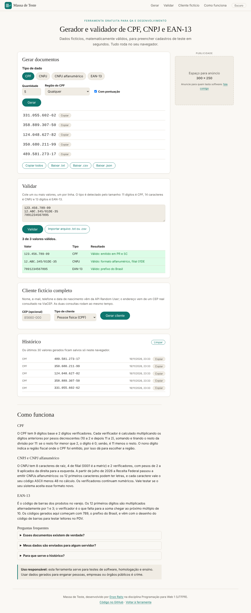
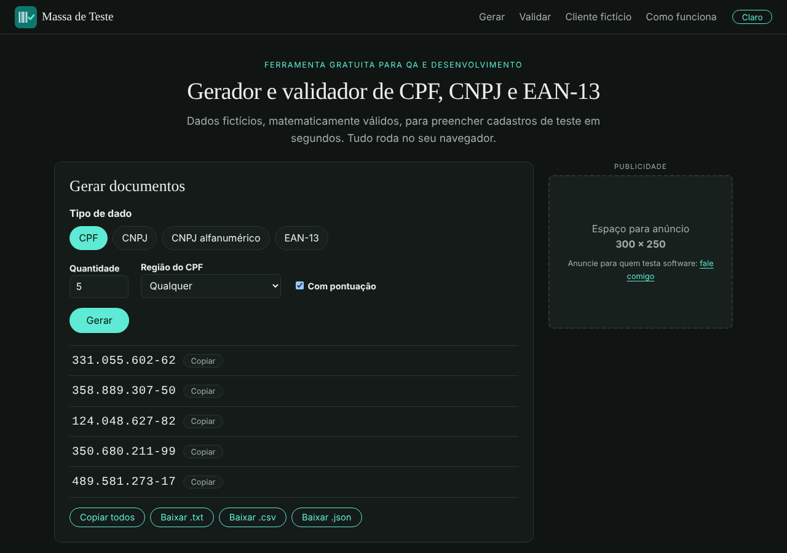
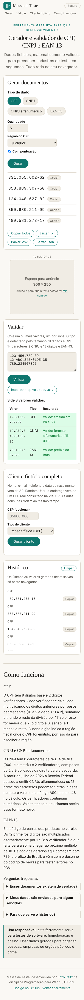

# Massa de Teste

**Aluno:** Enzo Raitz

**Disciplina:** Programação para Web 1 (UTFPR, Câmpus Dois Vizinhos)

**Serviço publicado:** https://raitz-enzo.github.io/MassaDeTeste/

**Site pessoal:** https://raitz-enzo.github.io/SitePessoal/

Projeto incremental 2: um serviço Web simples, útil e potencialmente rentável, feito só com HTML, CSS e JavaScript puro, sem back-end, publicado como site estático.

## O problema

> Que tarefa pequena alguém poderia pesquisar no Google e resolver usando o seu site?

Resposta: pesquisas como **"gerador de CPF"**, **"gerador de CNPJ"** e **"validar CNPJ alfanumérico"**.

Quem testa software (QA, desenvolvedores, analistas de implantação) precisa o tempo todo de documentos válidos para preencher cadastros de clientes, fornecedores e produtos em ambiente de homologação. Usar dados reais é proibido pela LGPD, e inventar números na mão não passa na validação do sistema.

- **Usuário:** profissional de QA ou desenvolvimento.
- **Problema único:** conseguir em segundos um dado fictício que passe na validação.
- **Por que eu:** trabalho como Analista de QA em ERP e Frente de Caixa, onde CPF, CNPJ e código de barras EAN-13 aparecem em quase todo roteiro de teste. A ferramenta já nasce com o que eu sinto falta no dia a dia, como o **CNPJ alfanumérico** (válido a partir de julho de 2026) e o desenho do código de barras para testar leitores no PDV.

## Funcionalidades

- Gerar CPF (com escolha da região fiscal), CNPJ, CNPJ alfanumérico e EAN-13, de 1 a 100 por vez, com ou sem pontuação.
- Validar um ou vários valores de uma vez, com detecção automática do tipo e o motivo do erro (por exemplo, "dígitos verificadores deveriam ser 25").
- Validar em lote importando um arquivo `.txt` ou `.csv`.
- Gerar um cliente fictício completo (pessoa física ou jurídica) com nome, e-mail, telefone, nascimento e endereço real a partir do CEP.
- Copiar um valor ou todos, e baixar o resultado em `.txt`, `.csv` ou `.json`.
- Histórico dos últimos 30 valores e preferências salvos no navegador.
- Tema claro e escuro, layout responsivo e espaço para anúncio 300 x 250.

## Estrutura

```
index.html        estrutura e conteúdo
estilos.css       apresentação (mesma identidade visual do site pessoal)
script.js         comportamento, separado por incremento
imagens/          favicon (SVG e PNG) e imagem de compartilhamento (capa.png)
capturas/         telas do serviço no desktop, no tema escuro e no celular
```

Layout seguindo o modelo do professor: no desktop, header, ferramenta à esquerda com anúncio 300 x 250 à direita, conteúdo complementar e footer; no celular, o anúncio desce para logo depois do gerador.

O CSS é **Mobile First**: a base é o layout de celular, em uma coluna e na ordem do HTML (gerador, anúncio, validador, cliente e histórico). As media queries só usam `min-width` e acrescentam o que muda em telas maiores:

| Largura | Media query | O que muda |
| --- | --- | --- |
| até 639 px | base, sem media query | uma coluna; menu abaixo da marca; histórico sem a hora |
| 640 px ou mais | `@media (min-width: 40rem)` | menu na mesma linha do header; espaçamentos e títulos maiores; histórico e cliente em colunas |
| 960 px ou mais | `@media (min-width: 60rem)` | ferramentas à esquerda e anúncio 300 x 250 fixo (`sticky`) em uma coluna lateral |

O anúncio fica dentro do `main`, logo depois do gerador. Assim a ordem do celular sai do próprio HTML, sem `order` nem `display: contents`, e o `main` continua sendo reconhecido pelos leitores de tela.

## Capturas

Desktop (1280 px):



Tema escuro:



Celular (390 px):



## Incrementos

### 1. JS básico

**Foco:** variáveis, tipos, operadores, condicionais, laços, funções, arrays e objetos.

Primeira versão funcional: os algoritmos de dígito verificador.

- CPF: pesos de 10 a 2 e de 11 a 2, módulo 11; o nono dígito define a região fiscal (array de objetos `REGIOES_CPF`).
- CNPJ: pesos de 2 a 9 da direita para a esquerda, módulo 11.
- CNPJ alfanumérico: cada caractere vale `código ASCII - 48` (`"A"` = 17), conforme a regra da Receita Federal. Conferido com o exemplo oficial `12.ABC.345/01DE-35`.
- EAN-13: pesos alternados 1 e 3, módulo 10, prefixo 789 (Brasil).
- Funções `gerar...`, `validar...` e `formatar...` para cada tipo e `validarQualquer`, que detecta o tipo pelo tamanho.

### 2. DOM e eventos

**Foco:** DOM, formulários e eventos.

- Formulários com `submit` e `preventDefault()`: nada recarrega a página.
- Resultados, tabela de validação e dados do cliente criados com `createElement` e `textContent` (sem injetar HTML vindo do usuário).
- Opções que aparecem e somem conforme o tipo escolhido (`change`), máscara do CEP enquanto digita (`input`) e aviso "Copiado!".
- Código de barras EAN-13 desenhado em SVG pelo JavaScript.

### 3. Persistência

**Foco:** `localStorage`.

- Preferências: último tipo, quantidade, região, pontuação, tipo de cliente e tema.
- Histórico dos últimos 30 valores gerados, com data e hora, e botão Limpar.
- Leitura, gravação e remoção protegidas com `try/catch`, para a ferramenta continuar funcionando em navegação privada.

### 4. APIs

**Foco:** `fetch`, HTTP e JSON.

- [Random User](https://randomuser.me/) (`?nat=br`): nome, e-mail, celular e nascimento de uma pessoa fictícia brasileira.
- [ViaCEP](https://viacep.com.br/): endereço a partir de um CEP informado ou sorteado de uma lista de CEPs reais.
- Verificação de `response.ok` e do campo `erro` da ViaCEP, com mensagens claras quando algo falha.

### 5. Assincronismo e concorrência

**Foco:** Promises, `async/await` e `Promise.all`.

- As duas consultas são independentes, então rodam ao mesmo tempo com `Promise.all`.
- Cada promessa trata o próprio erro com `.catch`: se uma API cair, a outra ainda é usada e o cliente sai com dados de reserva.
- Botão fica desabilitado com "Buscando..." durante a requisição (`finally` restaura).

### 6. Web APIs

**Foco:** recursos nativos do navegador.

- **Clipboard API:** copiar um valor, todos os valores ou o cliente em JSON (com reserva para navegadores antigos).
- **Blob + URL.createObjectURL:** baixar `.txt`, `.csv` (com BOM para o Excel) e `.json`.
- **File API:** importar um arquivo para validar em lote (`file.text()`). Aceita o próprio `.csv` exportado: o cabeçalho e a coluna de tipo são ignorados.
- **Web Share API:** compartilhar o cliente gerado no celular (o botão só aparece onde a API existe).
- **matchMedia:** o tema segue o sistema até o usuário escolher.

### 7. Publicação e monetização

**Foco:** GitHub Pages, SEO e publicidade.

- Publicado no GitHub Pages: https://raitz-enzo.github.io/MassaDeTeste/
- SEO: `title` e `meta description` com os termos que as pessoas pesquisam, `canonical`, títulos em hierarquia, conteúdo explicativo ("Como funciona" e perguntas frequentes).
- Compartilhamento: favicon, Open Graph e Twitter Cards com `imagens/capa.png` (1200 x 630).
- Espaço publicitário 300 x 250 reservado ao lado da ferramenta (desktop) e logo abaixo dela (celular).

## Estratégia de monetização (opcional)

1. **Google AdSense no espaço 300 x 250.** Buscas como "gerador de CPF" têm volume alto e constante; quem pesquisa volta várias vezes por semana, o que gera visualizações recorrentes. O bloco fica fora da área de clique dos botões para não atrapalhar o uso.
2. **Anúncio direto para um público de nicho.** O público é quase todo de TI: cursos de testes, ferramentas de automação, vagas de QA e empresas de software podem patrocinar o espaço por mês (o link "Anuncie" já leva ao meu e-mail).
3. **Afiliados.** Links para cursos e livros de testes de software no conteúdo complementar.
4. **Versão para equipes (futuro).** Gerar massas maiores (por exemplo, 10 mil registros em CSV) ou API para pipelines de CI, cobrada por assinatura.

O custo de hospedagem é zero (GitHub Pages) e não há banco de dados, então qualquer receita é lucro.

## Uso responsável

Os dados gerados são fictícios e servem apenas para testes, homologação e ensino. Um número gerado pode, por coincidência, pertencer a uma pessoa ou empresa real. Usar esses dados para enganar alguém é crime.

## Como testar localmente

Basta abrir o `index.html` no navegador. A Clipboard API e o compartilhamento funcionam melhor publicados (HTTPS) ou com um servidor local, por exemplo a extensão Live Server do VS Code.
